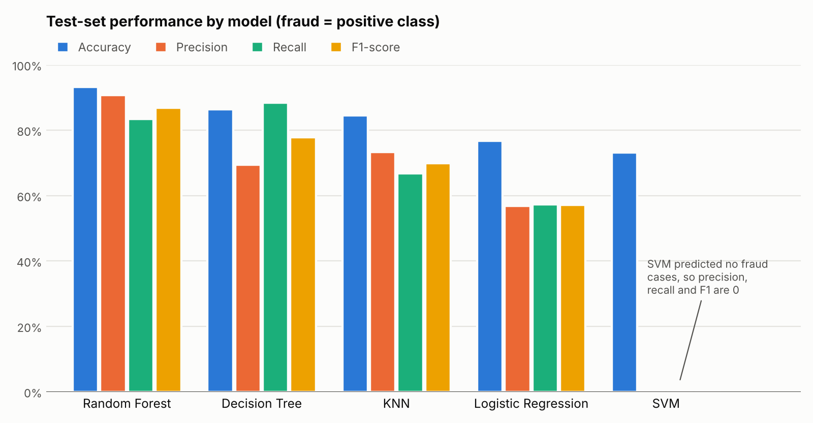

<div align="center">

# 🏦 Fraud Detection in Banks Using Machine Learning Algorithms

### Comparing five classical ML models for spotting fraudulent bank transactions

*K-Nearest Neighbors · Support Vector Machine · Decision Tree · Random Forest · Logistic Regression*


</div>

---

## 📖 Overview

Bank fraud costs financial institutions and their customers billions each year, and manual review is slow and error-prone. The hard part is catching fraud **without flooding analysts and customers with false alarms**.

This project trains and compares **five supervised machine learning classifiers** on a labelled dataset of bank transactions, then evaluates them with accuracy, precision, recall, F1-score and confusion matrices to find out which is best at separating fraudulent transactions from legitimate ones.

**Highlights**

- End-to-end workflow in one notebook: load → clean → split → train → evaluate → compare
- Five models evaluated side by side on an identical 80/20 train–test split
- Full set of metrics (accuracy, precision, recall, F1) plus confusion matrices
- Accompanying project report and slide deck included

> Developed as a course project for **21AIE205 – Python for Machine Learning**, Amrita Vishwa Vidyapeetham, Bengaluru (January 2023).

---

## 📊 Dataset

`fraud_detection_bank_dataset.csv` (sourced from Kaggle, included in this repository)

| Property | Value |
|----------|-------|
| Transactions | **20,468** |
| Features | **112** anonymized numeric columns (`col_0` … `col_111`) |
| Target | `targets` → renamed to `is_fraud` (1 = fraud, 0 = legitimate) |
| Class balance | 15,030 legitimate (73.43%) · 5,438 fraud (26.57%) |
| Missing values | None |
| Split | 80% train (16,374) / 20% test (4,094), `random_state=20` |

---

## 🔬 Approach

```
 Load CSV ──▶ Clean (drop index col, rename target) ──▶ Train/test split (80/20)
                                                              │
        ┌─────────────┬──────────────┬──────────────┬─────────┴────┐
        ▼             ▼              ▼              ▼              ▼
  Decision Tree      KNN       Random Forest      SVM      Logistic Regression
        └─────────────┴──────────────┴──────────────┴──────────────┘
                                      ▼
            Accuracy · Precision · Recall · F1 · Confusion matrix
```

| Model | Configuration |
|-------|---------------|
| **Decision Tree** | Entropy criterion, `max_depth=3` (an unrestricted tree is also trained for reference) |
| **K-Nearest Neighbors** | scikit-learn defaults (k = 5) |
| **Random Forest** | scikit-learn defaults |
| **Support Vector Machine** | `SVC` with default RBF kernel |
| **Logistic Regression** | scikit-learn defaults |

---

## 📈 Results

Test-set performance, with **fraud as the positive class**:

| Model | Accuracy | Precision | Recall | F1-score |
|-------|---------:|----------:|-------:|---------:|
| **Random Forest** | **93.26%** | **90.72%** | 83.47% | **86.94%** |
| Decision Tree (depth 3) | 86.44% | 69.47% | **88.47%** | 77.83% |
| K-Nearest Neighbors | 84.54% | 73.35% | 66.76% | 69.90% |
| Logistic Regression † | 76.80% | 56.78% | 57.40% | 57.09% |
| Support Vector Machine † | 73.11% | 0.00% | 0.00% | 0.00% |

<div align="center">

</div>

† Precision, recall and F1 for these two models were recomputed on the same split. The saved notebook output lists identical values for both, so the SVM and Logistic Regression metric cells are worth re-running.

**Takeaways**

- **Random Forest is the best overall model**, leading on accuracy, precision and F1. It also had the highest precision, which means fewer false alarms for bank staff.
- **The Decision Tree catches the most fraud** (88.5% recall) but flags more legitimate transactions (69.5% precision). An unrestricted tree reaches 90.5% accuracy.
- **Accuracy alone can mislead.** With 73.4% of transactions legitimate, a model that never predicts fraud scores about 73% accuracy, which is exactly what the SVM achieved. Features were used unscaled, a likely reason the distance-based SVM struggled.
- Ranking by test accuracy: Random Forest > Decision Tree > KNN > Logistic Regression > SVM.

---

## 🗂️ Repository Structure

```
.
├── pandas_final_conclusion (2).ipynb   # Main notebook: preprocessing, all five models, evaluation, conclusion
├── fraud_detection_bank_dataset.csv    # Dataset (20,468 transactions)
├── REPORT_ML.docx                      # Project report (Word)
├── TEAM-4.pdf                          # Project report (PDF)
├── OUTPUT_PROCESS_2_ML.pptx            # Project presentation (35 slides)
├── assets/
│   └── model_comparison.png            # Results chart used in this README
├── requirements.txt                    # Python dependencies
└── README.md
```

---

## ⚙️ Getting Started

### Installation

```bash
git clone https://github.com/Siddhartha80/FRAUD-DETECTION-IN-BANKS-USING-MACHINE-LEARNING-ALGORITHMS.git
cd FRAUD-DETECTION-IN-BANKS-USING-MACHINE-LEARNING-ALGORITHMS

python -m venv venv
source venv/bin/activate        # Windows: venv\Scripts\activate

pip install -r requirements.txt
```

### Run

```bash
jupyter notebook
```

Open **`pandas_final_conclusion (2).ipynb`**. In the cell that calls `pd.read_csv(...)`, replace the hardcoded Windows path with the bundled file:

```python
data = pd.read_csv("fraud_detection_bank_dataset.csv")
```

Then run all cells in order. The SVM step is the slowest.

---

## 🛠️ Tech Stack

- **Language:** Python
- **Machine learning:** scikit-learn (`DecisionTreeClassifier`, `KNeighborsClassifier`, `RandomForestClassifier`, `SVC`, `LogisticRegression`)
- **Data handling:** pandas, NumPy
- **Evaluation & visualization:** scikit-learn metrics, Matplotlib
- **Environment:** Jupyter Notebook

---

## 🚀 Future Work

- Scale features (e.g., `StandardScaler` in a pipeline) so distance- and margin-based models like SVM and KNN can perform fairly
- Handle class imbalance with class weights or resampling (e.g., SMOTE)
- Use cross-validation and hyperparameter tuning instead of a single split
- Try gradient-boosted models (XGBoost, LightGBM) and ensembles
- Report precision–recall curves and PR-AUC, which suit imbalanced fraud data
- Add model explainability (feature importance, SHAP) so analysts can see why a transaction was flagged

---

## 📚 References

1. Alkhatib, K. I., Al-Aiad, A. I., Almahmoud, M. H., & Elayan, O. N. (2021). *Credit Card Fraud Detection Based on Deep Neural Network Approach.* 12th International Conference on Information and Communication Systems (ICICS), pp. 153–156. [doi:10.1109/ICICS52457.2021.9464555](https://doi.org/10.1109/ICICS52457.2021.9464555)
2. Faraji, Z. (2022). *A Review of Machine Learning Applications for Credit Card Fraud Detection with A Case Study.* SEISENSE Journal of Management, 5(1), 49–59.

More details are in the project report (`REPORT_ML.docx` / `TEAM-4.pdf`).

---

## ⚠️ Disclaimer

This project is for educational purposes and was evaluated on a single anonymized benchmark dataset. It is not a production fraud-detection system and should not be used to make real financial decisions without further validation.

---

<div align="center">

⭐ If you find this project useful, consider giving it a star!

</div>
